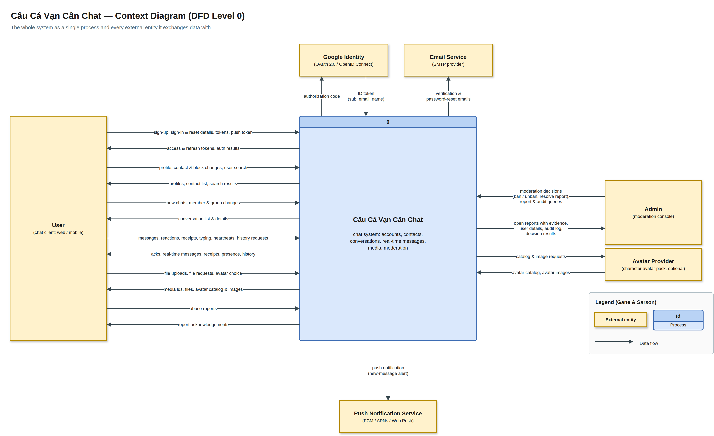
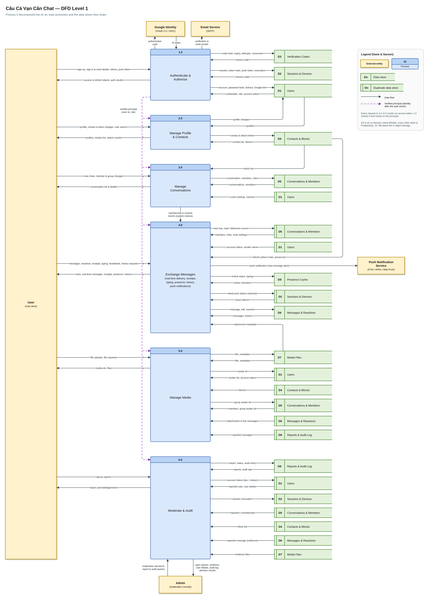
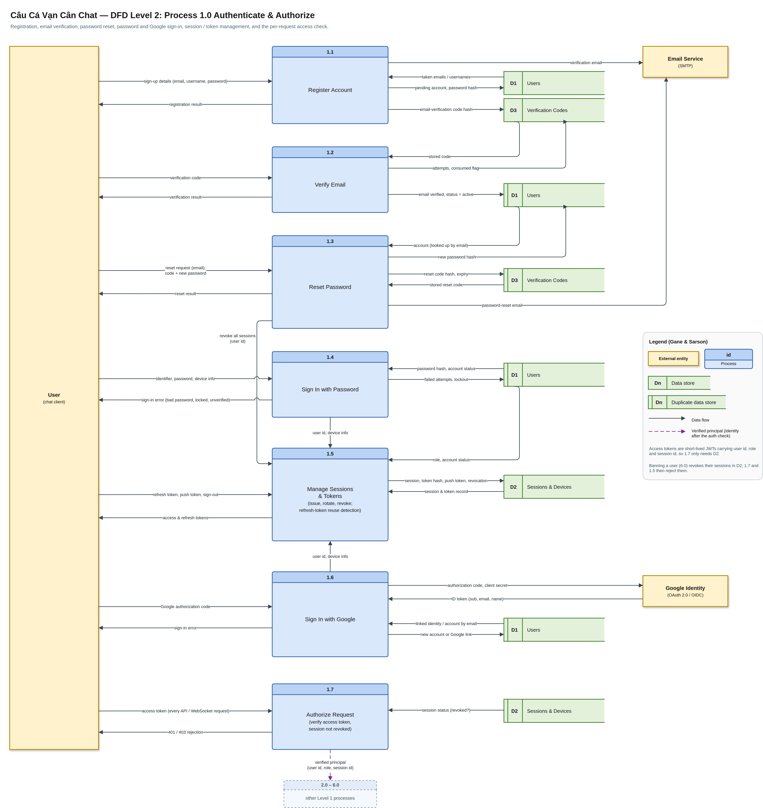
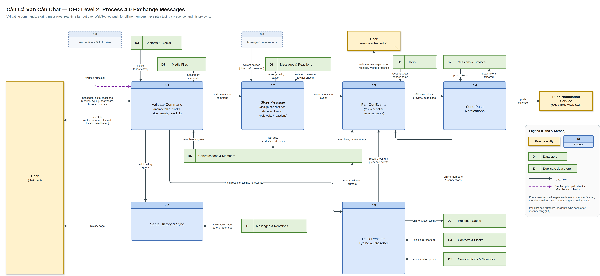
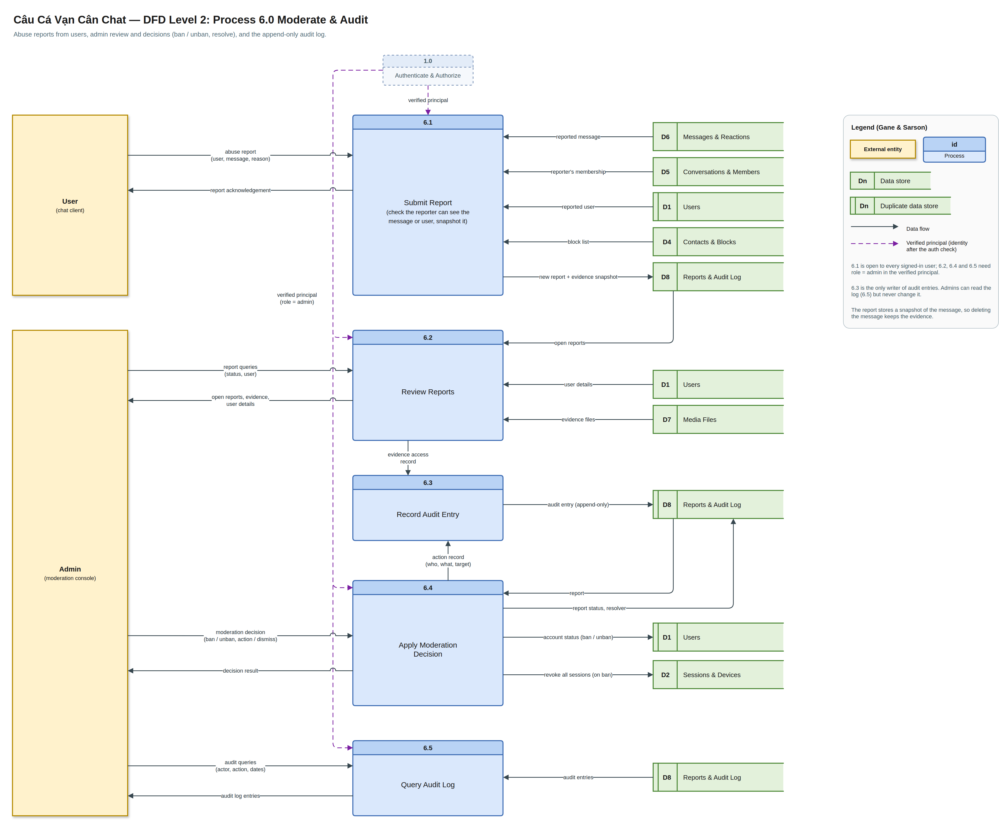
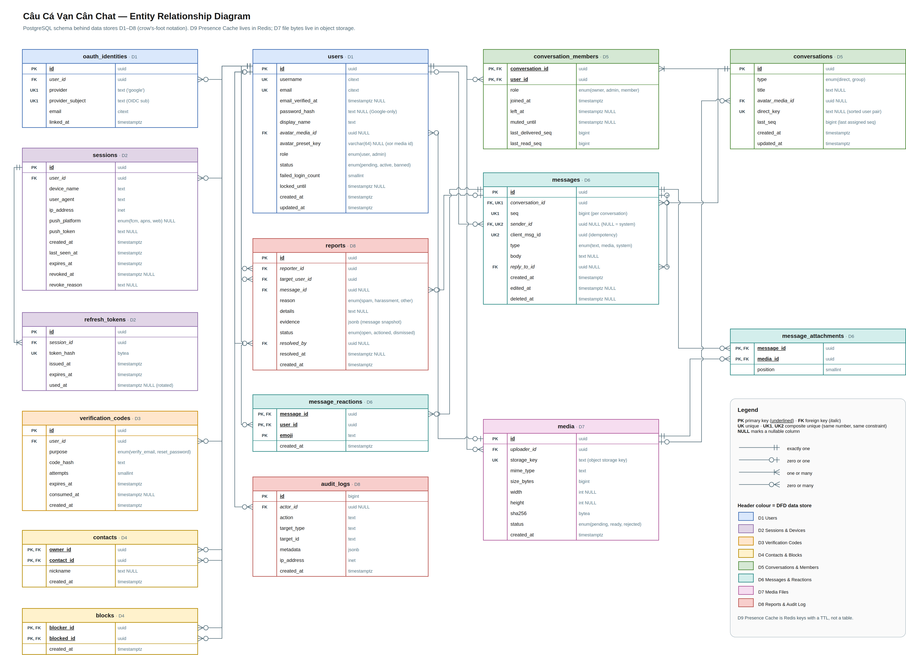

# Câu Cá Vạn Cân Chat — design docs

A chat app: one-to-one and group conversations, real-time delivery, media attachments, and basic
moderation. The frontend borrows its look from the fishing game *Câu Cá Vạn Cân*. That theme is
presentation only, so it does not appear in the diagrams below.

**It is not a social network.** There are no feeds, posts, followers, likes on profiles, or public
timelines. Users find each other by username, add them as contacts, and talk.

All diagrams are draw.io files in [diagrams/](diagrams/), each with a light-mode PNG export next to it.

| # | Diagram | Source |
|---|---------|--------|
| 1 | Context diagram (DFD level 0) | [01-context-dfd-level-0.drawio](diagrams/01-context-dfd-level-0.drawio) |
| 2 | DFD level 1 | [02-dfd-level-1.drawio](diagrams/02-dfd-level-1.drawio) |
| 3a | DFD level 2: 1.0 Authenticate & Authorize | [03a-dfd-level-2-auth.drawio](diagrams/03a-dfd-level-2-auth.drawio) |
| 3b | DFD level 2: 4.0 Exchange Messages | [03b-dfd-level-2-messaging.drawio](diagrams/03b-dfd-level-2-messaging.drawio) |
| 3c | DFD level 2: 6.0 Moderate & Audit | [03c-dfd-level-2-moderation.drawio](diagrams/03c-dfd-level-2-moderation.drawio) |
| 4 | Entity relationship diagram | [04-erd.drawio](diagrams/04-erd.drawio) |

## Notation

The DFDs use **Gane & Sarson** notation:

- **External entities** are yellow boxes.
- **Processes** are blue rounded boxes with the process number in the header.
- **Data stores** are green open-ended boxes with the store id. A store or entity drawn a second time
  to avoid long lines is marked as a duplicate: an extra bar for stores, a corner stroke for entities.
- **Data flows** are solid arrows.
- **The dashed purple arrow** is the *verified principal* (user id, role) that 1.0 hands to the other
  processes after checking a request's access token.

Levels are balanced: every flow entering or leaving a process on one level appears, split into
finer flows, on the level below.

The ERD uses **crow's-foot** notation. Each table's header colour matches the DFD data store it belongs to.

## 1. Context diagram (DFD level 0)



| External entity | Exchanges with the system |
|-----------------|---------------------------|
| User | Everything a chat client does: account, contacts, conversations, messages, files, abuse reports |
| Admin | Moderation console: reviews reports, bans or unbans users, reads the audit log |
| Google Identity | "Sign in with Google" (OAuth 2.0 / OpenID Connect code exchange) |
| Email Service | Verification and password-reset emails |
| Push Notification Service | New-message alerts for users with no live connection (FCM, APNs, Web Push) |

## 2. DFD level 1



| Process | Does |
|---------|------|
| 1.0 Authenticate & Authorize | Sign-up, sign-in, tokens, password reset, and the access check on every request |
| 2.0 Manage Profile & Contacts | Profile edits, user search, contact list, blocking |
| 3.0 Manage Conversations | Direct chats and groups, members and roles, rename, leave |
| 4.0 Exchange Messages | Send, edit and react; real-time delivery; receipts, typing, presence; history; push |
| 5.0 Manage Media | Upload, validate and serve files for attachments and avatars |
| 6.0 Moderate & Audit | Abuse reports, bans (which revoke sessions), audit log |

| Store | Holds | Tables (see ERD) |
|-------|-------|------------------|
| D1 Users | Accounts, credentials, linked Google identities | `users`, `oauth_identities` |
| D2 Sessions & Devices | One row per signed-in device, refresh tokens, push tokens | `sessions`, `refresh_tokens` |
| D3 Verification Codes | Email-verification and password-reset codes (hashed) | `verification_codes` |
| D4 Contacts & Blocks | Who a user saved and who they blocked | `contacts`, `blocks` |
| D5 Conversations & Members | Chats, membership, roles, mute, read and delivered cursors | `conversations`, `conversation_members` |
| D6 Messages & Reactions | Messages, attachments links, reactions | `messages`, `message_attachments`, `message_reactions` |
| D7 Media Files | File metadata (PostgreSQL) plus the bytes (object storage) | `media` |
| D8 Reports & Audit Log | Abuse reports with an evidence snapshot, admin action log | `reports`, `audit_logs` |
| D9 Presence Cache | Online status, live connections, typing (Redis keys with a TTL) | none |

## 3. DFD level 2

The processes with real internal logic are decomposed: auth, messaging, and moderation. Processes
2.0, 3.0 and 5.0 are mostly validate-then-read/write and are already fully described at level 1.

### 3a. Process 1.0 Authenticate & Authorize



| Sub-process | Does |
|-------------|------|
| 1.1 Register Account | Checks the email and username are free, stores a *pending* account with a password hash, emails a verification code |
| 1.2 Verify Email | Checks the code (limited attempts, expiry), marks it used, activates the account |
| 1.3 Reset Password | Emails a reset code; on a valid code stores the new hash and asks 1.5 to revoke every session |
| 1.4 Sign In with Password | Checks the hash and account status, counts failures, locks the account after repeated failures |
| 1.5 Manage Sessions & Tokens | Creates a session per device; issues a short-lived access token and a rotating refresh token; on refresh re-reads role and status; on refresh-token reuse revokes the whole session; signs out |
| 1.6 Sign In with Google | Exchanges the authorization code for an ID token, then finds the linked account, links by verified email, or creates a new one |
| 1.7 Authorize Request | Verifies the access token (a JWT with user id, role and session id) and that its session is not revoked, then passes the verified principal to 2.0–6.0 or rejects with 401/403 |

Banning a user in 6.0 revokes their sessions in D2, so both 1.5 and 1.7 reject them straight away.

### 3b. Process 4.0 Exchange Messages



| Sub-process | Does |
|-------------|------|
| 4.1 Validate Command | Checks membership and role, blocks (direct chats), attachment ownership and readiness, and rate limits; routes the command to 4.2, 4.5 or 4.6 |
| 4.2 Store Message | Assigns the next per-conversation `seq`, drops duplicates by `client_msg_id`, applies edits, deletes and reactions (sender-only edits), stores system notices from 3.0 |
| 4.3 Fan Out Events | Sends each event to every connected device of every member, which includes the sender's own ack; passes offline members on to 4.4 |
| 4.4 Send Push Notifications | Skips muted members and sends a short preview to each device's push token |
| 4.5 Track Receipts, Typing & Presence | Moves each member's read / delivered cursor, keeps online and typing state in Redis, and emits those events through 4.3 |
| 4.6 Serve History & Sync | Returns message pages before or after a `seq`, so a reconnecting client fills exactly the gap it missed |

### 3c. Process 6.0 Moderate & Audit



| Sub-process | Does |
|-------------|------|
| 6.1 Submit Report | Any signed-in user reports a user or message. Checks the reporter is a member of that message's conversation, then stores the report with a snapshot of the message as evidence |
| 6.2 Review Reports | Lists open reports with their evidence and the users involved. Every view of evidence is sent to 6.3, because admins are reading private messages |
| 6.3 Record Audit Entry | The only writer of the audit log. It records who did what to which target; entries are never updated or deleted |
| 6.4 Apply Moderation Decision | Bans or unbans a user and actions or dismisses a report. A ban sets the account status and revokes every session, so the user is signed out everywhere at once |
| 6.5 Query Audit Log | Lets admins search the audit log by actor, action and date |

6.2, 6.4 and 6.5 need `role = admin` in the verified principal; 6.1 is open to every user.

## 4. ERD



Design decisions worth knowing:

- **Message ordering and idempotency.** `messages.seq` is unique per conversation and gives a total
  order for sync. `(sender_id, client_msg_id)` is unique, so a client can retry a send without
  creating duplicates.
- **Allocating `seq`.** `conversations.last_seq` is the last number handed out. The send transaction
  locks the conversation row, increments `last_seq`, and uses the result as the message's `seq`, so
  numbers never repeat or skip. Do not derive the next `seq` from `MAX(seq)`.
- **One direct chat per pair.** `conversations.direct_key` (the two user ids, sorted) is unique for
  direct chats and NULL for groups.
- **Receipts as cursors.** `conversation_members.last_read_seq` and `last_delivered_seq` replace a
  per-message receipt table. That is one row per member instead of one per member per message.
- **Refresh-token rotation.** Each refresh marks the old `refresh_tokens` row `used_at` and issues a
  new one in the same session. Presenting a used token revokes the session.
- **System notices** ("Lan joined the group") are messages with `type = system` and `sender_id` NULL.
- **Report evidence** is a JSON snapshot of the reported message, so deleting the message does not
  destroy the evidence.
- **Admins** are users with `role = admin`. There is no separate admin table.

## API: auth

Implements processes 1.1–1.5 and 1.7. 1.6 (Google) is skipped for now. Design:
[specs/2026-10-31-auth-endpoints-design.md](superpowers/specs/2026-10-31-auth-endpoints-design.md).

| Process | Endpoint | Notes |
|---------|----------|-------|
| 1.1 | `POST /auth/register` | Creates a `pending` account and emails a 6-digit code |
| 1.2 | `POST /auth/verify-email`, `POST /auth/resend-verification` | Resend always answers 202 |
| 1.3 | `POST /auth/password-reset/request`, `POST /auth/password-reset/confirm` | Confirm revokes every session |
| 1.4, 1.5 | `POST /auth/login` | Email or username; 5 failures lock the account for 15 minutes |
| 1.5 | `POST /auth/refresh`, `POST /auth/logout` | Refresh tokens rotate; reuse revokes the session |
| 1.7 | `GET /auth/me`, `GET /auth/sessions` | Bearer token; the session is checked on every request |

Tokens: the access token is a 15-minute JWT (`sub`, `role`, `sid`). The refresh token is random, lasts
30 days (sliding) and is stored as a SHA-256 hash. Errors are `application/problem+json` with a
`code` field. Settings live under `Auth` and `Smtp` in `appsettings.json`; `Auth:JwtKey` and
`Auth:CodeKey` have no default outside Development.

## API: profile, contacts and blocking

Implements process 2.0. Every endpoint needs a bearer token.

| Endpoint | Notes |
|----------|-------|
| `PATCH /users/me` | Changes the display name (1-64 characters). Returns the same summary as `/auth/me` |
| `GET /users/{id}` | Public profile: id, username, display name, `isContact`, `isBlocked`. Never the email |
| `GET /users/search?q=&limit=` | Username prefix or display-name substring, case-insensitive. `q` is 2-64 characters, `limit` 1-50 (default 20) |
| `GET /contacts` | Sorted by nickname, else display name |
| `PUT /contacts/{id}` | Adds the contact or changes its nickname; the body is optional. Idempotent |
| `DELETE /contacts/{id}` | Idempotent |
| `GET /blocks`, `PUT /blocks/{id}`, `DELETE /blocks/{id}` | Blocking also removes the contact. Both calls are idempotent |

Rules:

- **A block hides you.** A user who blocked you looks exactly like a missing user (`404 user_not_found`)
  in lookups, search, the contact list and when adding a contact, so a block does not tell the blocked person
  where they stand. Someone *you* blocked gives `403 blocked` when you try to add them.
- Banned and pending users are invisible to lookups and search. You can still list and remove a block on a
  banned user.
- Contacts are private and one-way: adding someone does not add you to their list.
- Avatars are not here: they need media upload (5.0).

## API: conversations

Implements process 3.0. Every endpoint needs a bearer token. A conversation you are not an active member of
(never joined, removed, or left) answers `404 conversation_not_found`.

| Endpoint | Notes |
|----------|-------|
| `GET /conversations?limit=&before=` | Your conversations, newest activity first. `limit` 1-100 (default 50); pass the last `updatedAt` as `before` for the next page |
| `GET /conversations/{id}` | The conversation plus its active members |
| `POST /conversations/direct` | `{ userId }`. `201` for a new chat, `200` for the one that already exists |
| `POST /conversations/group` | `{ title, memberIds }`. The creator becomes owner. Title 1-100 characters, at least one other member |
| `PATCH /conversations/{id}` | `{ title }`. Owner or admin |
| `POST /conversations/{id}/members` | `{ userIds }`. Owner or admin. People already in are skipped |
| `DELETE /conversations/{id}/members/{userId}` | Owner removes anyone; an admin removes plain members only |
| `PUT /conversations/{id}/members/{userId}/role` | `{ role: "admin" \| "member" }`. Owner only, never for themselves |
| `POST /conversations/{id}/leave` | Groups only |
| `PUT /conversations/{id}/mute`, `DELETE /conversations/{id}/mute` | `{ until }` must be in the future. Per member; use a far date for "forever" |

Rules:

- **Direct chats** are keyed by the sorted pair of user ids (`direct_key`), so opening one from either side, or
  from both at once, gives the same row. They have no title, cannot be renamed or left, and show the other
  person as `peer`.
- **Blocks** are checked when a direct chat is opened and when people are added to a group, in the same way
  as for contacts: someone you blocked gives `403 blocked`, someone who blocked you looks like a missing user.
  Existing conversations are not touched. Refusing to deliver messages between blocked users belongs to 4.1.
- **Owners** leaving hand ownership to the longest-standing admin, else the longest-standing member. A group
  where everyone left stays in the database, empty.
- **Rejoining** gives a fresh member row state: role `member`, no mute, and read cursors at the current
  `last_seq`, so nothing from before shows as unread.
- A group holds at most 256 members.
- `unread` is `last_seq - last_read_seq`. Only sending moves it so far (your own cursor jumps to your new message);
  reading and delivery cursors for other members arrive with 4.5, so for them it counts every message.
- Group changes write system notices (`type = system`, no sender) in the same transaction; see "API: messaging".

## API: messaging

Slice 1 of process 4.0: 4.1 Validate Command, 4.2 Store Message, 4.6 Serve History & Sync and a single-node 4.3.
Redis (backplane, presence), RabbitMQ fan-out, 4.5 receipts / typing / presence and 4.4 push come in later slices.
Text messages only; media waits for 5.0.

**Connecting.** SignalR hub at `/hubs/chat`, authenticated with the access token. Browsers cannot set headers on a
WebSocket, so the hub also accepts `?access_token=...` (for this path only). The session check of 1.7 runs on connect.

**Commands** are hub methods. A failure is a `HubException` whose message ends with `HubException: <code>`, using the
same codes as the REST API.

| Method | Arguments | Returns |
|--------|-----------|---------|
| `SendMessage` | `conversationId`, `clientMsgId`, `body`, `replyToId?` | the stored message (also the ack) |
| `EditMessage` | `messageId`, `body` | the message |
| `DeleteMessage` | `messageId` | the message as a tombstone |
| `React` | `messageId`, `emoji`, `on` | nothing. `on` sets state (add / remove), so a retry cannot flip it |

**Events** go to every connected device of every active member, the sender's other devices included:
`message.created` (also for system notices), `message.edited`, `message.deleted` (all carry a message) and
`message.reaction` `{ conversationId, messageId, userId, emoji, on }`. A message is `{ id, conversationId, seq,
senderId?, clientMsgId, type, body?, replyToId?, createdAt, editedAt?, deletedAt?, reactions: [{ emoji, count, mine }] }`.
In events `mine` is always false, since one event goes to everyone.

**History:** `GET /conversations/{id}/messages?before=&after=&limit=` returns `{ messages, hasMore }` in ascending `seq`.
No cursor gives the latest page, `before` the page just older than that `seq`, `after` the messages newer than it (how a
reconnecting client fills its gap). `limit` 1-50 (default 50); `before` with `after` is a 400.

Rules:

- **Sending** trims the body (1-4000 characters), takes the next `seq` under the conversation lock and returns the
  original message when `clientMsgId` was already used by the same sender in that conversation; used in another
  conversation it is `409 conflict`. At most 20 sends per 10 seconds per user (`rate_limited`).
- **Blocks** in a direct chat refuse send, edit, delete and react in both directions. If the other person blocked you
  it looks like a missing user (`user_not_found`); if you blocked them it is `blocked`. History still works.
- **Edit and delete** are for your own messages. Anything you may not touch (someone else's, a system notice, a
  conversation you left) is `message_not_found`. Delete is soft: the row and its `seq` stay, `body` is set to null in the
  database, and history returns a tombstone. Deleting twice does nothing.
- **Every command re-checks the session** and that the user is active (`session_ended`), because a socket outlives its token.
- **System notices** have a JSON `body`: `{"kind":"member_added","actorId","userId"}`, `member_removed` (same fields),
  `member_left` (`userId`), `renamed` (`actorId`, `title`). Role changes write none. Someone removed or leaving also receives
  the notice that ends their membership. Clients render the text.
- **Known limit:** `seq` exists only for new messages, so edits, deletes and reactions made while a client was offline are not
  replayed by `after`. The client refetches the page it shows.

## Pitfalls

Traps in the schema and the stack are listed in [pitfalls.md](pitfalls.md).

## Editing the diagrams

The `.drawio` files are the source of truth. Edit them in draw.io: the desktop app, the VS Code
extension, or the official Docker image in a browser.

```bash
docker run -d --rm --name drawio -p 127.0.0.1:18080:8080 jgraph/drawio
# edit at http://127.0.0.1:18080 (File > Open from > Device)
```

To regenerate the PNGs in light mode, run the export script with that container running. It drives
draw.io's own export page through a local headless Chrome and needs Node 22 or newer.

```bash
node scripts/export-diagrams.mjs          # all diagrams
node scripts/export-diagrams.mjs erd      # only files whose name contains "erd"
docker stop drawio
```
